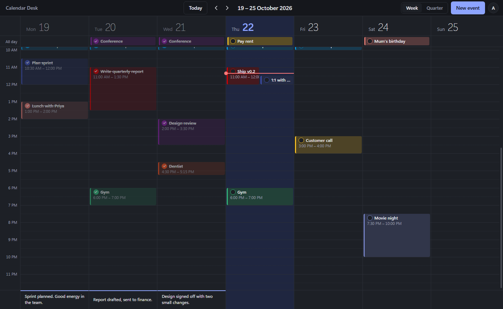
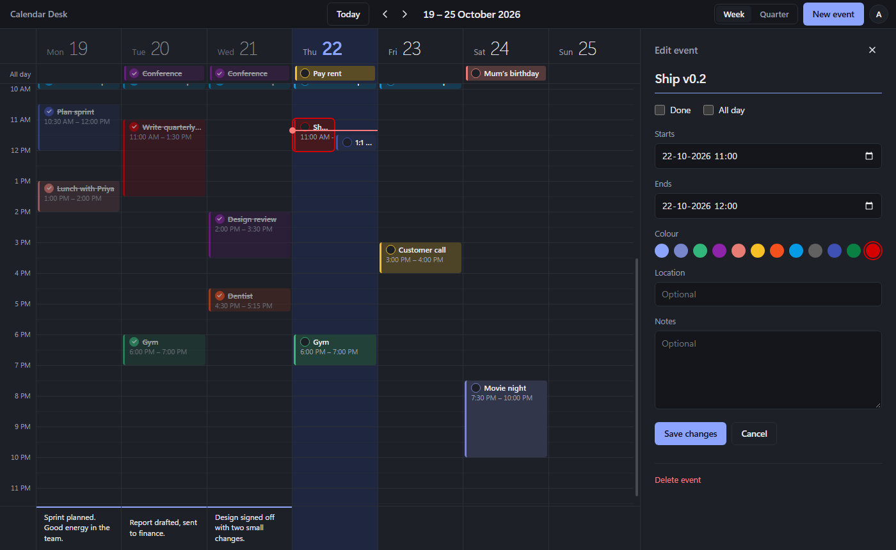
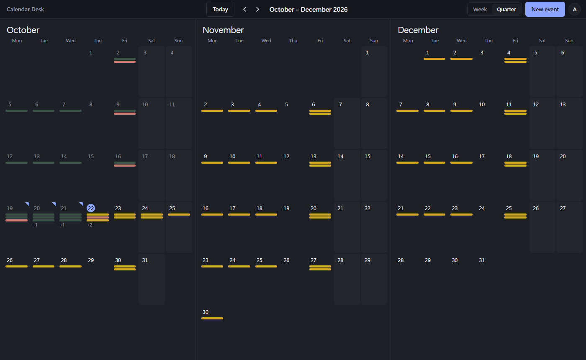

<div align="center">

# Calendar Desk

**Your Google Calendar on your Windows desktop: fast, keyboard-friendly, and yours.**

See your week or your whole quarter at a glance, drag events into place, tick them off as you go, and keep private notes for each day that never leave your PC.




</div>

---

## Features

| | |
|---|---|
| **Week and quarter views** | A time grid for the current week, or three months side by side. Switch with `W` / `Q`. |
| **Drag to plan** | Click or drag on empty space to create an event. Drag an event to move it, or drag its bottom edge to change its length. |
| **Done / not done** | Every event has a round tick. Click it to mark the event done: it turns green and is struck through everywhere it appears. |
| **Status colours** | 🟡 **Yellow**: coming up or in progress · 🔴 **Red**: its end time has passed and it isn't ticked · 🟢 **Green**: done. Events turn red the minute they end, with no refresh needed. |
| **Private day summaries** | Write a note for any day. It autosaves to a JSON file on your PC and is **never** sent to Google. |
| **Note formatting** | Day summaries and event notes have a small formatter: headings, bullet points, and bullets you can strike through as you finish them. |
| **Stays signed in, safely** | OAuth with PKCE in the main process. Tokens are encrypted with Windows DPAPI. |
| **Light and dark** | Follows your Windows theme, including the custom title bar. |

<table>
  <tr>
    <td></td>
    <td></td>
  </tr>
  <tr>
    <td align="center"><sub>Editor: title, times, Done checkbox, location and notes</sub></td>
    <td align="center"><sub>Quarter view: a status-coloured bar per event, folded corners mark days with a summary</sub></td>
  </tr>
</table>

## Getting started

### 1. Create a Google OAuth client (once, about five minutes)

1. Open the [Google Cloud Console](https://console.cloud.google.com/) and create a project (or pick an existing one).
2. **APIs & Services → Library**: search for *Google Calendar API* and click **Enable**.
3. **APIs & Services → OAuth consent screen** (called *Google Auth Platform* in newer consoles):
   - User type: **External**.
   - Fill in the app name and your email. You can skip the optional branding.
   - Under **Audience / Test users**, add the Google account whose calendar you want to use.
4. **APIs & Services → Credentials → Create credentials → OAuth client ID**:
   - Application type: **Desktop app**.
   - Copy the **Client ID** and **Client secret**.

You don't need to register a redirect URI. Desktop clients may redirect to `http://127.0.0.1:<any port>`, which is what the app uses.

> [!IMPORTANT]
> **The 7-day gotcha.** While the consent screen is in **Testing** status, Google expires refresh tokens after 7 days, so you'd have to sign in again every week. To avoid that, click **Publish app** on the consent screen page. Google will show an "unverified app" warning the next time you sign in: click **Advanced → Go to Calendar Desk (unsafe)** once. After that you stay signed in until you sign out.
> If your account is on Google Workspace, choose **Internal** as the user type instead. Internal apps need no verification and their tokens don't expire.

### 2. Configure and run

```bash
cp .env.example .env     # then paste the client ID and secret into .env
npm install
npm run dev              # starts the app with hot reload
```

On first launch your browser opens for Google sign-in, then hands you back to the app.

### 3. Build the Windows app

```bash
npm run build:win
```

This produces two files in `dist/` (both x64):

| File | What it is |
|---|---|
| `Calendar Desk Setup 0.1.0.exe` | An installer. Adds Calendar Desk to the Start menu and to *Installed apps* so you can uninstall it. |
| `Calendar Desk 0.1.0 Portable.exe` | A single file that runs without installing. Keep it anywhere, such as the desktop or a USB stick. It starts a little slower because it unpacks itself on each launch. |

Both use the same sign-in and summaries, so you can switch between them. Build on Windows: electron-builder can't build these on Linux or macOS without Wine.

> [!NOTE]
> The client ID and secret from `.env` are compiled into the build, so keep your installers private if that matters to you. Google treats desktop-app secrets as non-confidential anyway.

## ⌨️ Using it

| Action | How |
|---|---|
| Switch view | `W` week · `Q` quarter |
| Move through time | `←` / `→` one week or one quarter · `T` back to today |
| Create an event | **New event**, the **+** in a day header, a click or drag on empty grid space, or a click on the all-day row |
| Edit an event | Click it. Drag it to move, drag its bottom edge to resize |
| Mark done | Click the round tick on the event, or use **Done** in the editor |
| Read the colours | Yellow is upcoming, red is overdue, green is done. Hover an event to see its status |
| Open a day | Click a day's name in the week view, or any day in the quarter view |
| Format a note | Type `#` then space for a heading, or `-` then space for a bullet. You can also use the **H** and bullet buttons. `Enter` on an empty bullet ends the list |
| Strike a bullet | Click its dot, press `Ctrl+Enter`, or use the **S** button |
| Close the side panel | `Esc` |
| Sign out | Avatar at the top right. This also revokes the app's access at Google |

### Where your data lives

| What | Where | Leaves your PC? |
|---|---|---|
| Events | Your primary Google Calendar | Yes, it's Google Calendar |
| Status colours | Worked out live in the app from the clock and the tick. Nothing is stored, and colours set in Google Calendar are left untouched | No |
| Done ticks | A private property on each event, only readable by this app | Yes, so ticks follow you to other PCs |
| Day summaries | `%APPDATA%\calendar-desk\day-notes.json` | **No, never** |
| Sign-in tokens | `%APPDATA%\calendar-desk\google-auth.bin`, encrypted with DPAPI | No |

Summaries autosave about a second after you stop typing. Click **Show file** in the day panel to find the file, and back it up like any other file. Clearing a summary removes that day's entry.

## How it's built

Electron + React + TypeScript, bundled with [electron-vite](https://electron-vite.org/). The renderer is sandboxed with a strict CSP and talks to the main process only through a small typed bridge.

```
src/
  main/
    index.ts      window, custom title bar, IPC handlers, lifecycle
    auth.ts       OAuth loopback + PKCE, encrypted token store, sign-out/revoke
    calendar.ts   list (paginated) / insert / patch / delete, done flag
    notes.ts      local day summaries: atomic JSON writes, no network
  preload/
    index.ts      contextBridge → window.api (typed in shared/types.ts)
  renderer/src/
    App.tsx       auth, view mode and navigation, data loading, side-panel state
    components/   SignIn, TopBar, WeekGrid, QuarterGrid, DayPanel, EventEditor, DoneCheck, NoteEditor
    lib/          date helpers, event grouping, status colours, live clock
  shared/
    types.ts      CalendarEvent, EventInput, the Api contract
```

| Script | What it does |
|---|---|
| `npm run dev` | Run with hot reload |
| `npm run typecheck` | Type-check the main and renderer projects |
| `npm run build` | Production bundle into `out/` |
| `npm run build:win` | Typecheck, build and package the Windows installer |

## Extending it

- **Other calendars**: change `CALENDAR_ID` in `src/main/calendar.ts`. To offer a calendar picker, add the `https://www.googleapis.com/auth/calendar.calendarlist.readonly` scope in `auth.ts` and call `calendarList.list`.
- **Summaries elsewhere**: `src/main/notes.ts` is the only code that touches the summaries file. Swap its read and write functions to use SQLite or an encrypted store, with no UI changes.
- **Notifications and tray**: the main process already holds a long-lived auth client, so a periodic `events.list` plus Electron's `Notification` and `Tray` APIs fit in next to `registerIpc()`.
- **Attendees, recurrence, reminders**: updates use `events.patch`, so fields the editor doesn't show are left untouched. Recurring events are expanded into instances (`singleEvents: true`), so editing one changes only that instance.
